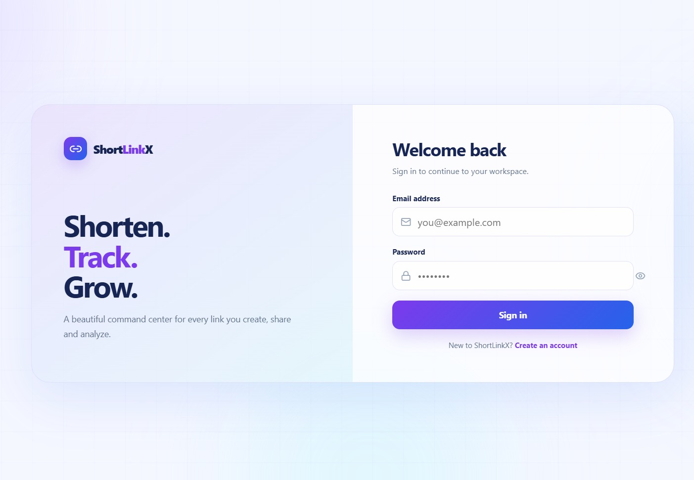
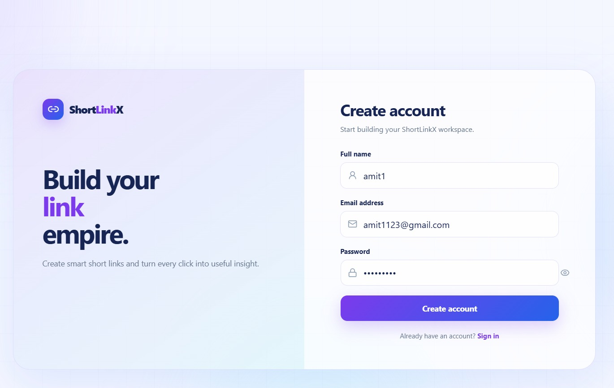
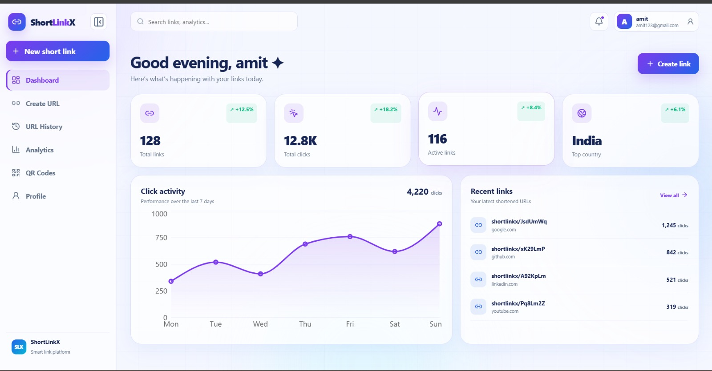
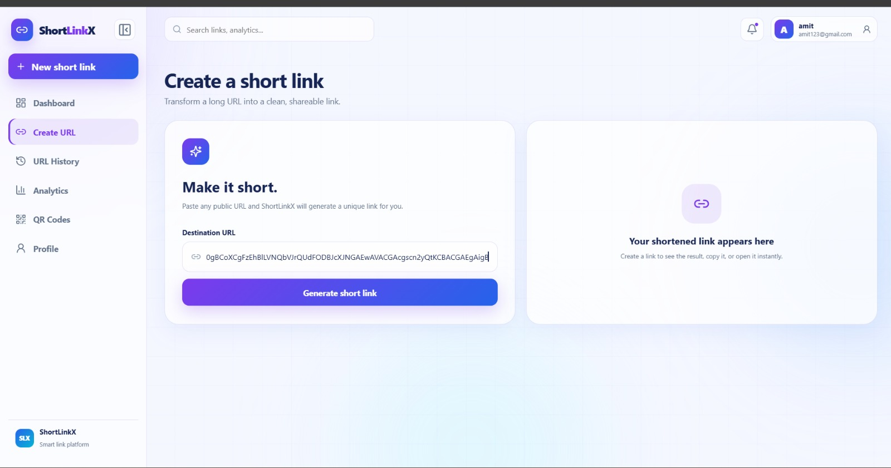
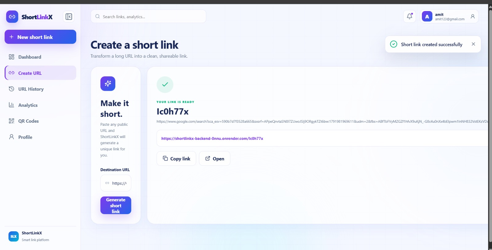
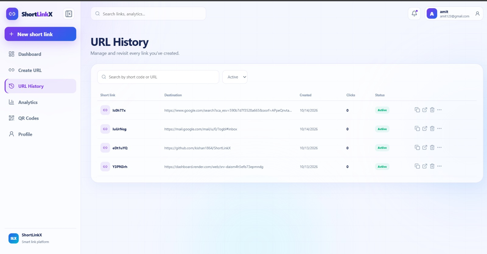
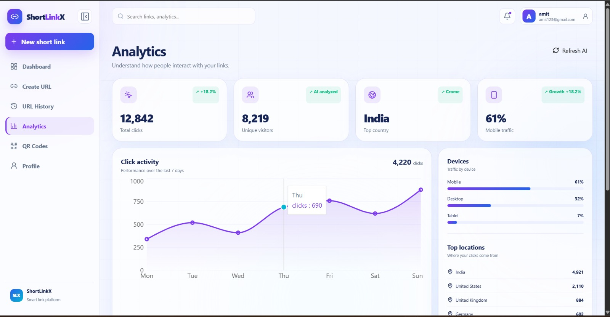
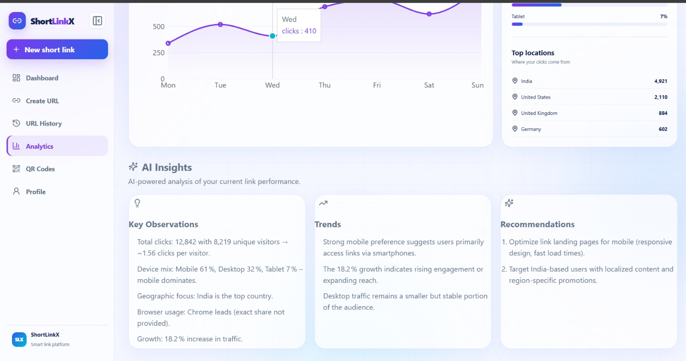
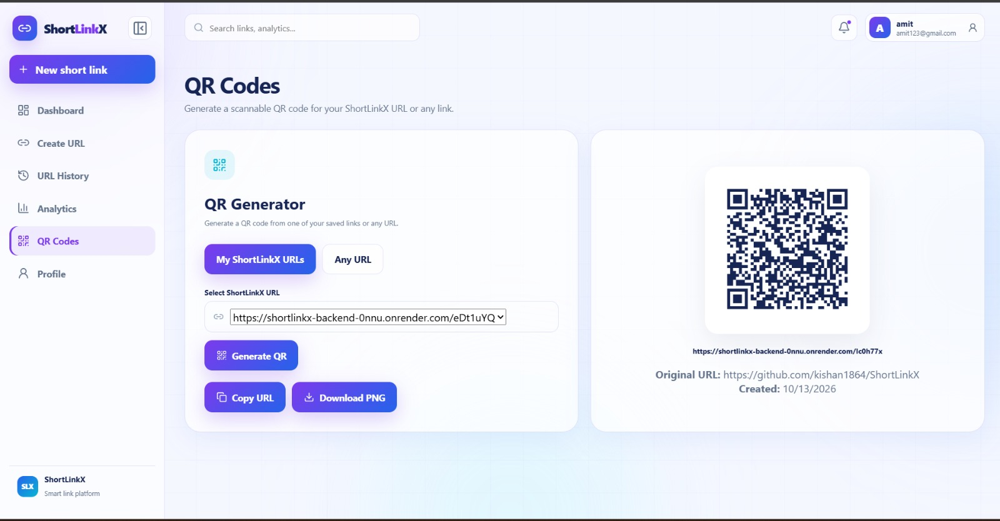
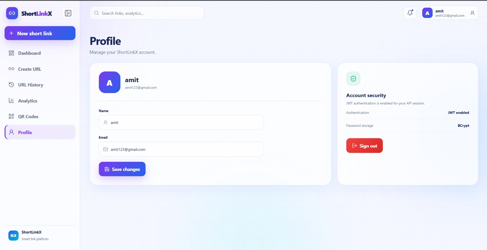

# ShortLinkX

<div align="center">

## AI-Powered URL Shortening and Link Management Platform

Create short links, manage URL history, generate QR codes, and explore AI-assisted analytics from one authenticated workspace.

[](https://www.java.com/)
[](https://spring.io/projects/spring-boot)
[](https://react.dev/)
[](https://www.postgresql.org/)
[](https://redis.io/)
[](https://spring.io/projects/spring-security)
[](https://www.docker.com/)
[](https://groq.com/)
[](https://render.com/)

**Live App:** https://shortlinkx-frontend-gewj.onrender.com  
**Backend:** https://shortlinkx-backend-0nnu.onrender.com  
**GitHub:** https://github.com/kishan1864/ShortLinkX

</div>

---

## Table of Contents

- [Overview](#overview)
- [Features](#features)
- [Architecture](#architecture)
- [Core Request Flows](#core-request-flows)
- [Screenshots](#screenshots)
- [API Overview](#api-overview)
- [Data Model](#data-model)
- [Redis Design](#redis-design)
- [Technology Stack](#technology-stack)
- [Project Structure](#project-structure)
- [Run Locally](#run-locally)
- [Configuration](#configuration)
- [Docker](#docker)
- [Deployment](#deployment)
- [Testing](#testing)
- [Security Notes](#security-notes)
- [Current Status](#current-status)
- [Roadmap](#roadmap)
- [Development Workflow](#development-workflow)
- [Author](#author)

---

## Overview

ShortLinkX is a full-stack URL shortening application built to demonstrate practical backend engineering and modern web development concepts.

The application allows authenticated users to create and manage short links, view their URL history, securely delete owned URLs, generate QR codes from saved short links or arbitrary URLs, and explore analytics and AI-generated insights.

The backend uses Java 21 and Spring Boot with Spring Security, JWT authentication, Spring Data JPA, PostgreSQL, and Redis caching. The frontend is built with React and Vite. The backend is containerized with Docker and the application is deployed on Render.

> Analytics and AI insight screens currently use demo/seeded metrics. Persistent real click-event analytics is a planned feature and is not claimed as complete yet.

---

## Features

### Authentication and security

- User registration and login
- Stateless JWT authentication
- BCrypt password hashing
- Protected REST APIs
- Authenticated profile endpoint
- Spring Security filter-chain integration
- CORS configuration for local and deployed frontend

### URL management

- Create short links from HTTP/HTTPS URLs
- 7-character Base62-style short-code generation
- Short-code collision checking
- Public short-link redirect
- User URL history
- Ownership-aware URL deletion

### QR generator

- Generate QR codes from saved ShortLinkX URLs
- Generate QR codes from any arbitrary URL
- Live QR preview
- Copy URL
- Download QR as PNG
- Arbitrary URLs used only for QR generation are not saved as shortened links

### Redis caching

- Short-code to original-URL caching
- Cache-aside pattern
- One-hour cache TTL
- Cache eviction on URL deletion
- PostgreSQL remains the source of truth
- Local development verified with Memurai
- Production configuration uses `REDIS_URL`

### AI analytics

- Groq-compatible AI integration
- AI-generated observations
- Trend interpretation
- Recommendations based on supplied analytics metrics

### Deployment

- React frontend on Render Static Site
- Spring Boot backend on Render Web Service
- PostgreSQL on Render
- Redis/Key Value service on Render
- Dockerized backend
- Environment-based configuration

---
## Screenshots

The screenshots below are stored in [`docs/screenshots/`](docs/screenshots/).

## 🔐 Authentication

Secure JWT authentication with a modern login interface.

<p align="center">
  
  
</p>

### Dashboard
<h2>📊 Dashboard</h2>

<p align="center">
  
</p>

### Create short URL

<p align="center">
  
</p>

### Short URL created successfully
<h2>🔗 Create URL</h2>

<p align="center">
  
</p>

### URL History
<h2>📜 URL History</h2>

<p align="center">
  
</p>

### Analytics overview
<h2>📈 Analytics</h2>

<p align="center">
  
</p>

### AI Insights
<h2>🤖 AI Insights</h2>

<p align="center">
  
</p>

### QR Generator
<h2>📱 QR Generator</h2>

<p align="center">
  
</p>

### Profile
<h2>👤 Profile</h2>

<p align="center">
  
</p>

---

## Architecture

### High-level architecture

```text
                              User Browser
                                   |
                                   v
                         +---------------------+
                         |    React + Vite     |
                         |      Frontend       |
                         +----------+----------+
                                    |
                               REST / JSON
                                    |
                                    v
                         +---------------------+
                         |     Spring Boot     |
                         |       Backend       |
                         +----------+----------+
                                    |
                 +------------------+------------------+
                 |                  |                  |
                 v                  v                  v
        +----------------+ +----------------+ +----------------+
        | Spring Security| | URL / User     | | AI Service     |
        | JWT + BCrypt   | | Services       | | + Groq API     |
        +----------------+ +-------+--------+ +----------------+
                                    |
                         +----------+----------+
                         |                     |
                         v                     v
                  +-------------+       +-------------+
                  |    Redis    |       | PostgreSQL  |
                  |    Cache    |       | Source of   |
                  |             |       | Truth       |
                  +-------------+       +-------------+
```

### Deployment architecture

```text
GitHub Repository
      |
      +----------------------+
      |                      |
      v                      v
Render Static Site      Render Web Service
React frontend          Spring Boot backend
                               |
                 +-------------+-------------+
                 |             |             |
                 v             v             v
            PostgreSQL      Redis/Key Value  Groq API
```

---

## Core Request Flows

### Authentication

```text
Register / Login
      |
      v
React
      |
      v
AuthController
      |
      v
AuthService
      |
      +--> validate request
      +--> check user
      +--> BCrypt password handling
      |
      v
PostgreSQL

Login additionally:
      |
      +--> AuthenticationManager
      +--> DaoAuthenticationProvider
      +--> UserDetailsService
      +--> JWT generation
```

For protected requests:

```text
React
  |
  | Authorization: Bearer <JWT>
  v
JwtAuthenticationFilter
  |
  +--> validate signature
  +--> validate expiration
  +--> extract subject
  +--> load user
  |
  v
SecurityContext
  |
  v
Protected Controller
```

### URL creation

```text
Long URL
   |
   v
Validate input
   |
   v
Generate short code
   |
   v
Check code uniqueness
   |
   v
Persist URL + owner in PostgreSQL
   |
   v
Return short URL
```

### Redirect with Redis

```text
GET /{shortCode}
        |
        v
   Spring Boot
        |
        v
      Redis
      /   \
    HIT   MISS
    |       |
    |       v
    |   PostgreSQL
    |       |
    |       v
    |    Redis SET
    |       |
    +-------+
        |
        v
  Original URL
        |
        v
     Redirect
```

### Delete and cache invalidation

```text
Delete owned URL
       |
       +----> PostgreSQL DELETE
       |
       +----> Redis EVICT
```

---


## API Overview

### Authentication

```http
POST /api/auth/register
POST /api/auth/login
```

### Current user

```http
GET /api/users/me
Authorization: Bearer <JWT>
```

### Create short URL

```http
POST /api/urls
Authorization: Bearer <JWT>
Content-Type: application/json
```

Example request:

```json
{
  "originalUrl": "https://example.com"
}
```

Example response:

```json
{
  "originalUrl": "https://example.com",
  "shortUrl": "http://localhost:8080/Ab12Xyz",
  "shortCode": "Ab12Xyz"
}
```

### Public redirect

```http
GET /{shortCode}
```

### Analytics

```http
GET /api/analytics/demo
GET /api/analytics/ai-insights
```

Demo analytics update:

```http
PUT /api/analytics/demo
Authorization: Bearer <JWT>
Content-Type: application/json
```

> QR generation is currently handled by the frontend and does not require a persistence API.

---

## Data Model

Current PostgreSQL structure:

```text
shortlinkx_db
└── public
    ├── users
    └── urls
```

### `users`

| Field | Purpose |
|---|---|
| `id` | Primary key |
| `name` | User display name |
| `email` | Unique login identifier |
| `password` | BCrypt password hash |
| `role` | User role |
| `created_at` | Account creation timestamp |

### `urls`

| Field | Purpose |
|---|---|
| `id` | Primary key |
| `original_url` | Original long URL |
| `short_code` | Unique generated short code |
| `created_at` | URL creation timestamp |
| `user` | Owning user relationship |

---

## Redis Design

Redis is used as a cache, not as the permanent database.

Example:

```text
Key:
shorturl:Ab12Xyz

Value:
https://example.com

TTL:
1 hour
```

### Cache-aside behavior

**First request:**

```text
Redis MISS
   |
   v
PostgreSQL lookup
   |
   v
Redis SET
   |
   v
Redirect
```

**Repeated request:**

```text
Redis HIT
   |
   v
Redirect
```

**Deletion:**

```text
PostgreSQL DELETE
   |
   v
Redis EVICT
```

### Environment-specific configuration

Local development:

```text
REDIS_URL not defined
        |
        v
redis://localhost:6379
```

Render:

```text
REDIS_URL=<Render internal Redis/Key Value URL>
```

---

## Technology Stack

| Layer | Technology | Purpose |
|---|---|---|
| Language | Java 21 | Backend language |
| Backend | Spring Boot 4.1.1 | REST API and application layer |
| Security | Spring Security | Authentication and authorization |
| Authentication | JWT | Stateless API authentication |
| Password hashing | BCrypt | Secure password storage |
| Persistence | Spring Data JPA / Hibernate | Database access and ORM |
| Database | PostgreSQL | Persistent data |
| Cache | Redis | Short-link redirect caching |
| Frontend | React + Vite | User interface |
| HTTP client | Axios | API communication |
| Routing | React Router | Frontend routing |
| Charts | Recharts | Analytics visualization |
| AI | Groq API | AI-generated insights |
| Build | Maven | Backend dependency/build management |
| Container | Docker | Backend packaging/deployment |
| Hosting | Render | Cloud hosting |

---

## Project Structure

```text
ShortLinkX/
│
├── backend/
│   ├── src/
│   │   ├── main/
│   │   │   ├── java/com/shortlinkx/
│   │   │   │   ├── ai/
│   │   │   │   ├── auth/
│   │   │   │   ├── config/
│   │   │   │   ├── controller/
│   │   │   │   ├── dto/
│   │   │   │   ├── entity/
│   │   │   │   ├── exception/
│   │   │   │   ├── repository/
│   │   │   │   ├── security/
│   │   │   │   ├── service/
│   │   │   │   │   ├── UrlService.java
│   │   │   │   │   └── UrlCacheService.java
│   │   │   │   ├── user/
│   │   │   │   └── util/
│   │   │   └── resources/
│   │   │       └── application.properties
│   │   ├── test/
│   │   └── Dockerfile
│   └── pom.xml
│
├── frontend/
│   ├── src/
│   │   ├── components/
│   │   ├── context/
│   │   ├── pages/
│   │   ├── services/
│   │   └── styles/
│   ├── package.json
│   └── vite.config.js
│
├── docs/
│   └── screenshots/
│       ├── login.jpeg
│       ├── register.jpeg
│       ├── dashboard.jpeg
│       ├── create-url.jpeg
│       ├── create-url-success.jpeg
│       ├── history.jpeg
│       ├── analytics-overview.jpeg
│       ├── ai-insights.jpeg
│       ├── qr-generator.jpeg
│       └── profile.jpeg
│
├── .gitignore
├── README.md
└── ...
```

---

## Run Locally

### Prerequisites

- Java 21
- Maven, or the included Maven Wrapper
- PostgreSQL
- Node.js and npm
- Git
- Redis-compatible server; Memurai is suitable for Windows development

### Backend

```bash
cd backend
./mvnw spring-boot:run
```

Windows:

```powershell
.\mvnw.cmd spring-boot:run
```

Backend:

```text
http://localhost:8080
```

### Frontend

```bash
cd frontend
npm install
npm run dev
```

Frontend normally starts at:

```text
http://localhost:5173
```

If that port is already occupied, Vite may use another port such as `5174`.

### Local Redis

With Memurai running:

```cmd
memurai-cli.exe ping
```

Expected:

```text
PONG
```

---

## Configuration

The backend uses environment variables for external services and secrets.

```properties
spring.application.name=shortlinkx

spring.datasource.url=jdbc:postgresql://${DB_HOST}:${DB_PORT}/${DB_NAME}
spring.datasource.username=${DB_USERNAME}
spring.datasource.password=${DB_PASSWORD}
spring.datasource.driver-class-name=org.postgresql.Driver

spring.jpa.hibernate.ddl-auto=update
spring.jpa.show-sql=false
spring.jpa.properties.hibernate.format_sql=true

server.port=${PORT:8080}

app.jwt.secret=${JWT_SECRET}
app.jwt.expiration=86400000

app.groq.api-key=${GROQ_API_KEY}
app.groq.model=${GROQ_MODEL:openai/gpt-oss-20b}
app.groq.endpoint=${GROQ_ENDPOINT:https://api.groq.com/openai/v1/chat/completions}

spring.data.redis.url=${REDIS_URL:redis://localhost:6379}
```

### Backend environment variables

```text
DB_HOST
DB_PORT
DB_NAME
DB_USERNAME
DB_PASSWORD

JWT_SECRET

GROQ_API_KEY
GROQ_MODEL
GROQ_ENDPOINT

REDIS_URL
```

### Frontend

```text
VITE_API_URL
```

### Secret rule

Never commit real values for:

```text
DB_PASSWORD
JWT_SECRET
GROQ_API_KEY
REDIS_URL
```

Use local environment configuration and Render environment variables.

---

## Docker

The backend is containerized with a multi-stage Docker build:

```text
Maven + Java 21
      |
      v
Build Spring Boot JAR
      |
      v
Java 21 JRE image
      |
      v
Run app.jar
```

Build:

```bash
cd backend
docker build -t shortlinkx-backend .
```

Run:

```bash
docker run -p 8080:8080 shortlinkx-backend
```

Docker is used for backend packaging/deployment. Docker Compose is not part of the current stack.

---

## Deployment

ShortLinkX is deployed on Render.

### Frontend

```text
Service: Render Static Site
Root Directory: frontend
Build Command: npm ci && npm run build
Publish Directory: dist
```

### Backend

```text
Service: Render Web Service
Runtime: Docker
Root Directory: backend
```

### Production services

```text
Render Frontend
       |
       v
Render Backend
   |      |      |
   v      v      v
Postgres Redis  Groq
```

The backend receives production connection information through Render environment variables. The Redis connection should use the internal URL of the Redis/Key Value service.

### Live URLs

- Frontend: https://shortlinkx-frontend-gewj.onrender.com
- Backend: https://shortlinkx-backend-0nnu.onrender.com
- GitHub: https://github.com/kishan1864/ShortLinkX

---

## Testing

### Authentication

- Register a user
- Login with valid credentials
- Verify invalid credentials are rejected
- Verify protected endpoints require authentication

### URL management

- Create valid HTTP and HTTPS URLs
- Reject blank or malformed URLs
- Verify unique short-code generation
- Open a public short URL
- Verify URL history
- Delete an owned URL
- Verify users cannot delete another user's URL

### QR generator

- Select a saved short link
- Generate the QR code
- Copy the URL
- Download the PNG
- Enter an arbitrary URL
- Generate its QR code without creating a saved short link

### Redis

A successful cache-aside test looks like:

```text
Request 1 -> MISS -> PostgreSQL -> SET
Request 2 -> HIT
```

Also verify:

```text
TTL is present
Delete URL -> Redis key is evicted
```

### AI analytics

- Read the current demo metrics
- Request AI insights
- Update demo metrics
- Request AI insights again
- Verify that the interpretation changes with the supplied metrics

---

## Security Notes

### Password security

```text
Plain password
      |
      v
    BCrypt
      |
      v
Password hash
      |
      v
 PostgreSQL
```

### JWT security

The backend validates token signature, subject, and expiration before creating the authenticated security context.

### URL ownership

URL deletion is performed using the authenticated user context so users cannot intentionally delete links owned by other users.

### Cache consistency

PostgreSQL is the durable source of truth. Redis is a cache. URL deletion evicts the corresponding cache key.

### Secret management

Credentials and secrets are kept out of source control and supplied through environment variables.

---

## Current Status

| Capability |  Status  |
|---|:--------:|
| React frontend | Complete |
| Spring Boot backend | Complete |
| JWT authentication | Complete |
| BCrypt password hashing | Complete |
| PostgreSQL persistence | Complete |
| URL shortening | Complete |
| Short-code collision checking | Complete |
| Public redirect | Complete |
| User URL history | Complete |
| Secure URL deletion | Complete |
| QR generator | Complete |
| QR from arbitrary URL | Complete |
| AI insights | Complete |
| Dockerized backend | Complete |
| Render deployment | Complete |
| Redis cache - local | Complete |
| Redis cache - production rollout | Complete |
| Persistent real click analytics | Planned  |
| Real dashboard metrics from click events | Planned  |
| Rate limiter |  Future  |
| Swagger / OpenAPI |  Future  |
| Docker Compose |  Future  |
| API Gateway / microservices |  Future  |
| Kafka |  Future  |
| Load balancing |  Future  |
| Monitoring / distributed tracing |  Future  |
| Kubernetes |  Future  |

---
| Feature | Status |
|---------|:------:|
| JWT Authentication | ✅ |
| PostgreSQL | ✅ |
| URL History | ✅ |
| QR Generator | ✅ |
| Redis Cache | ✅ |
| AI Insights | ✅ |
| Click Counter | 🚧 |
| Dashboard from DB | 🚧 |
| Real Analytics | 🚧 |

## Roadmap

### Phase 1 - Core platform

- Authentication
- JWT
- PostgreSQL
- URL shortening
- AI integration
- Cloud deployment

### Phase 2 - Product features

- User URL history
- Secure URL deletion
- QR generation
- Dashboard UI
- Analytics UI

### Phase 3 - Performance and real analytics

- Redis caching
- Real click counter
- Persistent click events
- Real analytics derived from stored click events
- Dashboard metrics backed by real data

### Future system design

- Rate limiting
- Swagger / OpenAPI
- Docker Compose
- API Gateway
- Microservices
- Kafka and asynchronous processing
- Load balancing
- Monitoring
- Distributed tracing
- Kubernetes

> Future items are intentionally not presented as implemented features.

---

## Development Workflow

```bash
git status
git add .
git commit -m "your message"
git push origin main
```

Example:

```bash
git add README.md docs/screenshots
git commit -m "docs: upgrade project README"
git push origin main
```

---

## Author

<div align="center">

### Kishan Sahu

GitHub: https://github.com/kishan1864  
Project: https://github.com/kishan1864/ShortLinkX  
Live Demo: https://shortlinkx-frontend-gewj.onrender.com

</div>

---

<div align="center">

### ShortLinkX

**Shorter links. Smarter insights.**

Built with Java, Spring Boot, React, PostgreSQL, JWT, Redis, Docker, and AI integration.

</div>
